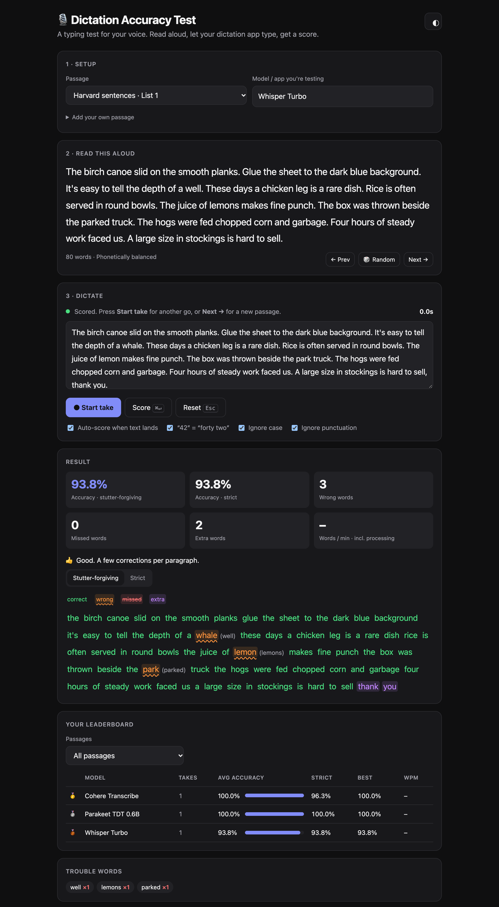

<div align="center">

# 🎙️ Dictation Accuracy Test

**A typing test for your voice.**
Read a passage aloud with *any* dictation app, and get a word-by-word accuracy score.

[](https://harrism04.github.io/dictation-accuracy-test/)
&nbsp;
[](https://github.com/harrism04/dictation-accuracy-test/actions)
&nbsp;
[](LICENSE)
&nbsp;


<br>



</div>

---

## Why this exists

Every dictation app says it's "accurate". But benchmarks are run on clean studio audio from people who aren't you. What matters is:

- **your** voice, accent, pace and quirks,
- **your** mic and room,
- **the words you actually say** (names, jargon, numbers).

This tool lets you measure that in a couple of minutes, and compare models side by side. It was built to pick the best **local** model in [OpenWhispr](https://github.com/OpenWhispr/openwhispr) (Parakeet vs Cohere Transcribe vs Whisper…), but it works with **anything that types text**: Wispr Flow, macOS/Windows dictation, Superwhisper, MacWhisper, Talon, Dragon…

## ✨ Features

| | |
|---|---|
| 🎯 **Word Error Rate scoring** | Industry-standard WER with a word-level diff: wrong, missed and **extra** (hallucinated) words, colour-coded. |
| 🗣️ **Stutter-forgiving mode** | Fillers (*um, uh*), repeated words (*I I I*) and part-word starts (*p-p-picked*) are removed before scoring, so an engine isn't punished for faithfully writing a stutter. A **strict** score is always shown alongside. |
| 🔢 **Smart normalisation** | `42` = *forty two*, `14th` = *fourteenth*, `$320` = *three hundred twenty dollars*, `9:30` = *nine thirty*, `Dr.` = *doctor*. Case and punctuation ignored (toggleable). |
| ⏱️ **Hands-free flow** | Press **Start take**, hold your dictation hotkey, read. The score appears automatically when the text lands. Includes words-per-minute. |
| 🏆 **Personal leaderboard** | Label each take with the model you're testing and see averages, best scores and speed per model, per passage or overall. |
| 🧩 **Trouble words** | See which words your setup keeps getting wrong across every take. |
| 📚 **13 built-in passages** | Harvard sentences (the phonetically balanced set used in speech research), numbers & money, names & places, dev jargon, homophones, plosives, tongue twisters, long-form… |
| ✍️ **Your own passages** | Paste text you really say: your stand-up update, your product names, your field's jargon. |
| 💾 **Export / import** | JSON and CSV export (including transcripts), JSON import to merge results across browsers. |
| 🔒 **100% private** | Static HTML + JS. No server, no analytics, no uploads. Results live in your browser's localStorage. |
| 🌗 **Light & dark** | Follows your system, or toggle it. Works on mobile too. |

## 🚀 Quick start

### Use it online

👉 **<https://harrism04.github.io/dictation-accuracy-test/>**

### Or run it locally (no install, works offline)

```bash
git clone https://github.com/harrism04/dictation-accuracy-test.git
cd dictation-accuracy-test
open index.html            # macOS  (or just double-click it)
```

Prefer a local server? `npm start` (runs `python3 -m http.server 8000`) and open <http://localhost:8000>.

## 🧪 How to run a fair test

1. **Pick a passage** and type the **model name** you're testing (e.g. `Parakeet TDT 0.6B`).
2. Press **● Start take**. The text box is focused for you.
3. **Hold your dictation hotkey and read the passage** at your natural pace.
4. Release. Your app types into the box and the score appears ~1.5 s later.
5. Repeat **3+ times per model**, then switch models in your dictation app and do the same.

> [!TIP]
> **Turn off AI cleanup / "polish" / rewriting** in your dictation app to measure the raw speech model. Turn it back on to measure what you'll actually get day-to-day. Both are useful numbers, just don't mix them in one leaderboard row.

> [!NOTE]
> **Words per minute includes processing time.** The timer runs from *Start take* until text arrives, so it measures speaking + transcription. Takes under 2 s (pasted/typed text) don't get a WPM.

### Testing OpenWhispr local models

1. In OpenWhispr → *Settings → Speech-to-Text*, choose **Local** and download the models you want to compare (e.g. **Parakeet TDT 0.6B**, **Cohere Transcribe**, **Whisper Turbo**).
2. Select one, do 3 takes here, labelled with its name.
3. Switch model in OpenWhispr, change the label here, repeat.
4. Check the leaderboard. 🏆

## 📐 How scoring works

**Word Error Rate** is the standard speech-recognition metric:

```
WER = (Substitutions + Deletions + Insertions) / words in the passage
Accuracy = 1 − WER   (floored at 0%)
```

Both texts go through the same normalisation (lower-case, strip punctuation, expand numbers & common abbreviations), then are aligned word-by-word with Levenshtein distance.

| Mode | What's removed before scoring | Use it to answer |
|---|---|---|
| **Stutter-forgiving** *(headline)* | Fillers (*um, uh, er, hmm*), immediate repeats (*the the*), part-word starts ≤ 3 letters (*p p picked*) | "How much will I need to edit?" |
| **Strict** | Nothing | "How literally does it transcribe me?" |

If the two numbers differ by more than 2 points, the result tells you that some of the "errors" were disfluencies.

> [!IMPORTANT]
> A handful of takes is a *personal* signal, not a scientific benchmark. Small differences (1-2 %) between models are often within take-to-take noise. Look for consistent gaps over several takes and passages.

## 📚 Built-in passages

| Category | Passages | Stresses |
|---|---|---|
| Phonetically balanced | Harvard sentences · Lists 1 & 2 | All English phonemes in natural proportion ([IEEE 1969](https://www.cs.columbia.edu/~hgs/audio/harvard.html)) |
| Everyday | Plain prose · Conversational · Work email | Typical dictation |
| Tricky content | Numbers, dates & money · Names & places · Developer jargon · Homophones | Formatting, proper nouns, vocabulary, context |
| Hard sounds | Plosives · Hard sentence openers · Tongue twisters | Blocks & repetitions on p/b/t/d/k/g, rapid articulation |
| Endurance | Long-form paragraph | Drift and dropped words over ~100 words |

Want to add one? Edit [`js/passages.js`](js/passages.js) and open a PR.

## 🛠️ Development

Zero dependencies. Plain HTML, CSS and JavaScript, no build step.

```
index.html          UI
css/style.css       Styles (light/dark tokens)
js/scoring.js       Normalisation + WER alignment (works in browser and Node)
js/passages.js      Reading passages
js/app.js           Take flow, leaderboard, history, import/export
tests/              Unit tests (node:test) + headless-Chrome smoke test
```

```bash
npm test             # unit tests for scoring (Node 22+)
npm run e2e          # browser smoke test via headless Chrome (no deps; set CHROME=... if needed)
npm run screenshot   # regenerate docs/screenshot.png
```

## 🗺️ Ideas / roadmap

- [ ] Character error rate (CER) alongside WER
- [ ] Shareable result cards
- [ ] Optional "record audio" mode to replay the exact same take through multiple engines
- [ ] More languages and passage packs

Contributions welcome! Issues and PRs are open.

## 🙏 Acknowledgements

- [OpenWhispr](https://github.com/OpenWhispr/openwhispr), the open-source dictation app that inspired this.
- The **Harvard sentences** from the *IEEE Recommended Practice for Speech Quality Measurements* (1969).
- The [Hugging Face Open ASR Leaderboard](https://huggingface.co/spaces/hf-audio/open_asr_leaderboard), for keeping model benchmarks honest.

## 📄 License

[MIT](LICENSE). Do whatever you like with it.
